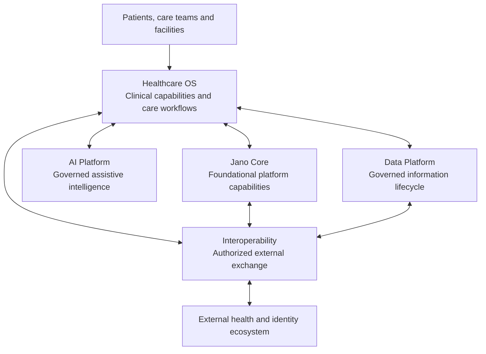

# Jano Health — conceptual architecture

**Status:** public architecture overview; exploratory and not formally approved.

## Purpose

Jano Health is being designed as modular healthcare infrastructure rather than an EHR-only product or a standalone clinical chatbot. Its intended value is to improve how care information, clinical workflows, governed intelligence and authorized integrations fit together.

## Logical areas

The diagram shows logical relationships only. It does not define runtime topology, network paths, deployment units, technology choices, API details, or clinical authority rules.

## Responsibility at a glance

| Area | Public-level responsibility |
|---|---|
| Healthcare OS | Clinical information and care-delivery capabilities, with domain ownership and accountable clinical governance. |
| Jano Core | Shared platform foundations such as identity references, organizational context and platform-level controls. |
| AI Platform | Assistive AI capabilities that operate within explicit intended-use and governance boundaries. |
| Data Platform | Stewardship of data quality, lifecycle, information products and analytics. |
| Interoperability | Contract-governed exchange with authorized external systems and standards. |

## Boundaries

- Clinical records remain governed by their authoritative clinical domain and accountable owner.
- AI output does not independently become a diagnosis, prescription, order, or clinical record.
- External identity providers remain external authorities; Jano must maintain its own internal references and authorization model.
- Exchange with an external system requires a defined purpose, lawful basis, partner authorization, and an agreed technical contract.
- A logical architecture diagram is not proof that a capability has been implemented or validated.
